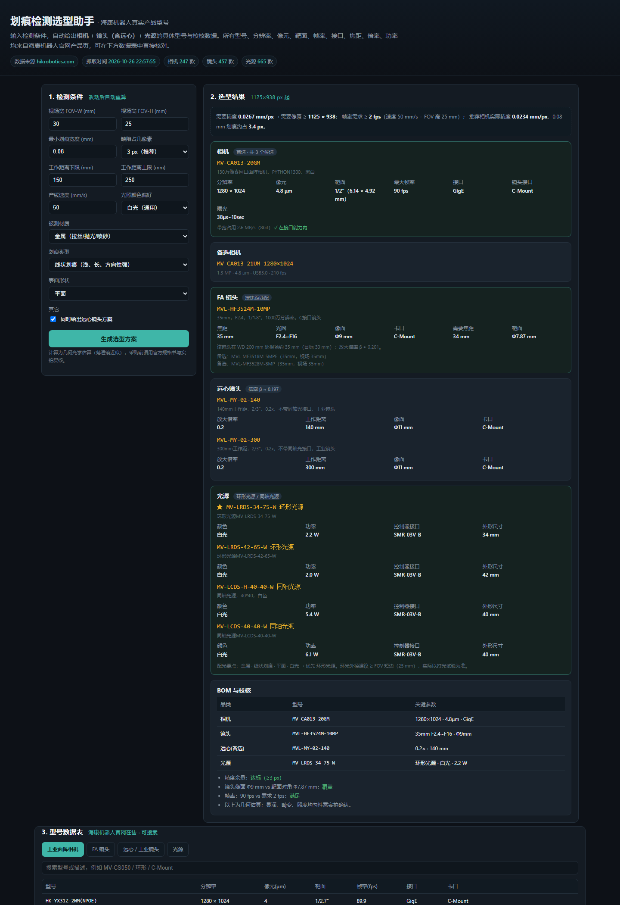
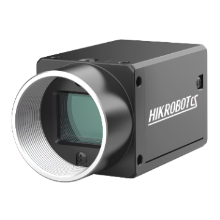
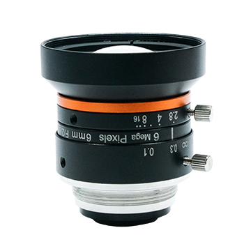

# 划痕检测选型助手 · 海康机器人实型号版

一个打开即用的单页工具：输入检测条件，自动输出**相机 + 镜头（含远心）+ 光源**的**海康机器人真实型号**，并给出精度、带宽、帧率、像面覆盖的校核结果。

> 所有型号与参数（分辨率、像元、靶面、帧率、接口、焦距、倍率、功率）均抓取自 [hikrobotics.com](https://www.hikrobotics.com/cn/machinevision) 机器视觉产品页，抓取时间 **2026-10-26**。工具只做**几何光学估算**，采购前以官方规格书与实拍为准。



---

## 1. 数据规模（全部为在售真实型号）

| 品类 | 数量 | 字段来源 |
|---|---|---|
| 工业面阵相机 | **247** 款（黑白、1.2–20 MP、GigE/USB3.0 子集） | 官网产品列表 + 产品详情参数 |
| FA 镜头（MVL 系列） | **124** 款 | 官网镜头列表 |
| 远心 / 工业镜头 | **333** 款 | 官网镜头列表 |
| 光源（标准系列 + 风格系列） | **665** 款 | 官网光源列表 |

相机字段：分辨率、像元尺寸、靶面、最大帧率、数据接口、镜头接口、曝光时间；
镜头字段：焦距 / 放大倍率、F 数、像面尺寸、接口类型；
光源字段：类型（环形 / 条形 / 同轴 / 背光 / 穹顶…）、颜色、功率、控制器接口。

原始数据在 [`data/`](data)：`hik_products.json`（列表全量）、`hik_camera_params.json`（相机详情参数）、`hik-data.js`（工具内联版）。

---

## 2. 选型逻辑（可复核）

**① 相机**
```
所需精度 (mm/px) = 最小划痕宽度 ÷ 缺陷像素数        (默认 3 px，可调 2–5)
所需像素 = FOV ÷ 所需精度                          (长边短边都要满足，允许相机旋转 90°)
```
在满足分辨率的机型中，优先「接口带宽 / 帧率达标」，再取**像素最少**的一档（省钱）。带宽按 8bit 估算：GigE ≈ 118 MB/s、USB3.0 ≈ 350 MB/s、10GigE ≈ 1100 MB/s。

**② FA 镜头**
```
靶面宽/高 (mm) = 分辨率 × 像元
放大倍率 β ≈ 靶面宽 ÷ FOV 宽
焦距 f ≈ WD × 靶面宽 ÷ (FOV 宽 + 靶面宽)
约束：镜头像面 ≥ 靶面对角线；卡口与相机一致
```

**③ 远心镜头**（可选）
```
倍率 β ≈ 靶面高 ÷ FOV 高        （±15% 内匹配，且工作距离落在输入范围内）
```

**④ 光源**（按「材质 × 划痕类型 × 表面形状」推荐）

| 场景 | 首选照明 |
|---|---|
| 金属线状划痕 / 微裂纹 | 低角度**环形光**（暗场，划痕散射进镜头）、抛光面加**同轴光** |
| 玻璃 / 透明件 | **背光**或**平行面光**（透射），辅以暗场环光 |
| 塑料 / 涂层 | **条形光**（掠射）、**环形光** |
| 凹坑 / 压痕 | **穹顶光**（无影均匀） |
| 油污 / 指纹 | **同轴光**（抑制表面反射差异） |
| 圆柱 / 曲面 | **穹顶光** 优先 |

推荐结果给出具体型号、颜色、功率与控制器接口，并附「环光外径 ≥ FOV 短边」等经验提示。

---

## 3. 使用方式

- **在线**：打开 GitHub Pages 链接（本仓库根目录 `index.html`）。
- **离线**：直接双击 `index.html`（数据已内联，无需联网、无需构建）。
- 调整左侧任一参数会即时重算；下方「型号数据表」四个页签可搜索、核对全部在售型号。

---

## 4. 目录结构

```
index.html                     # 工具本体（数据已内联，单文件可用）
data/
  hik_products.json            # 官网列表全量抓取（相机/镜头/光源）
  hik_camera_params.json       # 247 款相机详情参数
  hik-data.js                  # 工具使用的紧凑数据集
scripts/
  fetch_hik.py                 # 抓取产品列表（分页）
  fetch_camera_params.py       # 抓取相机详情参数（并发）
  build_site.py                # 数据整理 + 注入模板，生成 index.html
  index.template.html          # 页面模板（含 __DATA__ 占位符）
docs/img/                      # 官方产品图与工具截图
```

更新数据（官网改版或需要更大范围机型时）：

```bash
python scripts/fetch_hik.py            # 列表：相机 / 镜头 / 光源
python scripts/fetch_camera_params.py  # 相机详情（像元、靶面、曝光…）
python scripts/build_site.py           # 重新生成 index.html
```

抓取走官网自身接口（`POST /cn/Api/Foreground/Vision/VisionProductContent`、`GET .../VisionProductConfig?id=`），无需登录。

---

## 5. 参考图

| | |
|---|---|
|  面阵相机（MV-CS050 系列） |  FA 镜头（MVL-HF 系列） |
|  环形光源（MV-LRDS 系列） | 暗场照明原理见工具内「选型原理」板块 |

---

## 6. 局限（必读）

- 计算为**薄透镜几何估算**：未包含景深、畸变、相对照度、镜头 MTF 与光源辐照度分布，需实拍验证。
- 光源「角度」以官网标注为准，不同系列的标注口径可能不同，不能直接横比。
- 相机库仅覆盖**黑白、1.2–20 MP、GigE/USB3.0** 子集；线阵、10GigE、CoaXPress、彩色机型需用脚本抓取全量后扩展。
- 型号与参数以海康机器人官方最新规格书为准，本工具不替代原厂选型支持。

## 7. 变更记录

| 版本 | 内容 |
|---|---|
| v2.0 | 改用海康机器人真实型号（相机 247 / 镜头 457 / 光源 665）；新增远心镜头方案、光源选型模块、带宽与像面校核、全量数据表 |
| v1.0 | 基于通用参数的手工计算页面 |
